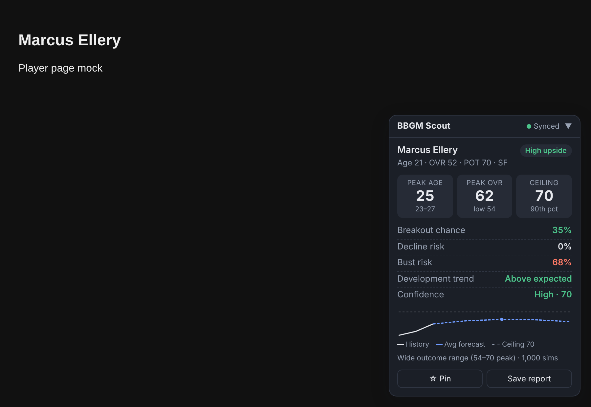

# BBGM Scout

A browser extension for Basketball GM: player development outlooks, a hidden-gem assistant, trade help, free-agent and draft tools, automatic team management, and an Autopilot that sims seasons while managing your team. Settings, pins and reports sync across devices.



## What it shows

| Metric | How it's calculated |
|---|---|
| **Peak age** | Median age of the player's career-high OVR across simulated careers (the middle-50% range is shown below it) |
| **Peak OVR** | Median career-high OVR (the 10th percentile is shown as "low") |
| **Ceiling** | 90th-percentile career-high OVR |
| **Breakout chance** | P(gain ≥ 5 OVR next season) |
| **Decline risk** | P(lose ≥ 5 OVR next season) |
| **Bust risk** | P(peak OVR stays below the benchmark). The default benchmark is POT − 5, or you can set a fixed OVR in Settings |
| **Development trend** | Actual OVR change over the last 3 seasons vs. what BBGM's progression rules expected, given the player's ratings and age at the time |
| **Confidence** | 0–100. Goes down when the outcome range is wide, scouting fog applies, the player has little history, or real-player determinism is on |

## Tools (each can be turned on or off in the popup's Features tab)

The dock in the bottom corner of every BBGM league page has one tab per tool. Click its header (or ▼ Close / ▲ Open) to collapse or expand it. The ◐ button switches between Auto, Light and Dark mode; the popup has the same button.

**Hover cards** (on by default): hover over any player's name anywhere in BBGM to see their outlook, hidden-gem verdict, value to your team, contract or asking price, draft rank, playing time and injury.

| Tab | What it does | Default |
|---|---|---|
| **Outlook** | The development card above, on any player page | On |
| **AI** | Says whether a player is a **hidden gem**, overvalued or fair, and why. Also lists the best hidden gems around the league. Optional **Ask Claude** box for free-form questions | On (Ask Claude off) |
| **Trades** | Shops your players and picks to every AI team using BBGM's own trading-block AI, so every offer is one they'd accept. Ranks the offers by how much they raise your **team rating**. Refreshes every game day and grades whatever deal is on the trade screen | On |
| **Targets** | Players on other teams worth adding. "Ask" runs BBGM's "What would make this work?" and grades the answer | On |
| **FA** | Free agents ranked by value for the money (forecast value minus asking salary), with Sign buttons and the reason when you can't sign someone | On |
| **Draft** | Draft board ranked by the Scout model next to BBGM's own ranking. Auto Drafter can suggest or make your pick, and can trade up when your top target won't last | Off |
| **Manager** | Auto Team Management and Autopilot (below), plus an activity log with Undo | Off |
| **Needs** | Team needs scanner: your three biggest weaknesses compared with every team (outside shooting, inside scoring, ball handling & passing, perimeter defense, rim protection, rebounding, athleticism, bench depth, star power), each linked to the best trade target, free agent and draft prospect to fix it, with Ask / Sign buttons | On |
| **Plan** | The next three seasons: projected team rating and league rank, committed payroll, cap space, expiring contracts and your picks, with warnings (stars declining before prospects are ready, a closing window, a cap crunch, no first-rounders). Also where you set **Never trade / Ask first / Available** for every player and pick | On |
| **Realism** | Records league-wide numbers every season (stars per team, parity, payrolls vs. the cap, max contracts, long injuries, scoring, three-point rate) and suggests God Mode / league setting tweaks as the years go on. For example: a hard cap or higher luxury tax when dynasties form, inflation when the cap never changes, a different Three Point Tendency Factor when the style drifts from the modern NBA. Suggestions only; it never changes settings | On |

**Team rating and trades.** Trades are judged with BBGM's own team-rating formula: predicted margin of victory from your top 10 OVRs, where 1 point is about 2.7 wins over 82 games. The manager only makes a trade if it raises that rating:
- **Contending:** right now.
- **Rebuilding:** averaged over the next two seasons, using the forecasts.
- **Balanced:** both.

There's no limit on how many trades it makes. Because each one has to strictly improve the team, it can't churn back and forth.

**Auto Team Management.** Each part has its own switch. Choose "Suggest" (you approve each move) or "Fully automatic".
- **Finances:** budget style (win now, balanced or profit) and auto ticket price.
- **Lineup:** keeps the roster auto-sorted.
- **Playing time:** gives more minutes to your best players when contending, and to young high-upside players when rebuilding. Gives fewer minutes to the end of the bench, and benches injured players and anyone below the rotation. Optional tanking. In BBGM, minutes don't affect progression, but they do affect player mood.
- **Re-signing:** re-signs players worth their asking price and lets the rest walk.
- **Roster cuts:** releases the lowest-value players when the roster is over the limit.
- **Free agents:** signs players to fill the roster, within the cap.
- **Trades:** as described above.

**Protected assets and contract rules.** Mark any player or pick as *Never trade* or *Ask first* (Plan tab, or the Outlook card for your own players). Protections are synced per league.
- *Never trade:* no automated feature will trade, cut or let that asset walk, and the Trade Helper never shops it or offers it.
- *Ask first:* automated features may propose a move involving it, but it always waits for your approval, even in fully automatic mode and in Autopilot.

You can also set the longest contract the manager may give and how much cap space to always keep free. Signings, re-signings and trades that break these rules are skipped or flagged.

**Autopilot.** Like BBGM's Auto Play, but your team keeps being managed by the rules above instead of the game's AI. It plays a day (or a week) at a time through the regular season, playoffs, draft, re-signing, free agency and preseason. Before every step it runs the manager and the Auto Drafter. It stops after the number of seasons you choose, at an optional checkpoint, when you press Stop, or if BBGM needs your attention.

**How actions happen.** A small script in the BBGM page calls the same internal functions BBGM's own buttons use (`bbgm.toWorker`). Only an allow-listed set of actions is possible. The game enforces its rules (cap, roster limits, trade deadline, player willingness) and records undo entries. Read-only league snapshots go through BBGM's official worker-console mechanism. Nothing writes to the league database directly.

**Ask Claude.** Off by default. Add your Anthropic API key in Features. The key is stored only on this device and never synced. Pick any current Claude model (Claude Opus 5.5 is the default). Your question and a short summary of the relevant players are sent to the Claude API, billed to your account. Your league file is never sent.

## How the model works

BBGM Scout doesn't use a guessed age curve. Each season it applies BBGM's own progression rules to the player's 15 individual ratings: the age-based base change, the random noise, each rating's age modifiers and change limits, and the coaching-budget effect. It then recomputes OVR with BBGM's formula, and runs about 1,000 simulated careers per player through age 36. Because it starts from the full ratings vector, two players with the same OVR but different builds get different forecasts. For example, a player whose OVR is mostly athleticism will age worse than one whose OVR is mostly IQ.

**Scouting fog.** On by default. For players outside your team, the forecast starts from the fuzzed ratings BBGM shows you and averages over the uncertainty implied by your scouting budget. It never peeks at true ratings. You can turn this off in Settings.

**Development trend is descriptive.** In BBGM, each year's progression is independent of past years, so a player who over-developed last year isn't more likely to do it again. The trend row tells you how the player got here; it doesn't shift the forecast.

This is an independent re-implementation of BBGM's published mechanics for personal use. BBGM's source is available to read but is not open source, so don't redistribute this extension as if it were affiliated with BBGM.

## Works with any league

Open any Basketball GM league in the browser and BBGM Scout attaches to it automatically. It reads the league number from the page address and the game's live state every few seconds. That includes random leagues, real-player leagues, custom and uploaded leagues, and leagues mid-season or mid-sim. Settings, pins and reports are shared across leagues; protections, the Realism history and trade timing are kept per league. Things to know:
- Only leagues on play.basketball-gm.com (or beta.basketball-gm.com) in a browser where the extension is installed. It can't reach leagues on another device or in the mobile app.
- Multi-team mode and spectator mode: the scouting tools work, but leave the Manager and Autopilot off (they assume you control one team).
- Real-player leagues with "real player development" on are flagged as lower confidence, because real careers override BBGM's random progression.

## Install

**Chrome / Edge / Brave / Arc (Mac, Windows, Linux):**
1. Go to `chrome://extensions` and turn on **Developer mode**.
2. Click **Load unpacked** and pick this `bbgm-scout` folder.

**Firefox:** go to `about:debugging` → This Firefox → **Load Temporary Add-on**, then pick `manifest.json`. For a permanent install, sign the extension through addons.mozilla.org as an unlisted add-on.

**Safari (Mac):** run `xcrun safari-web-extension-converter bbgm-scout/` and build the generated Xcode project.

You'll need to install it on each browser you use. There's no hosted web version.

## Cloud sync

Settings, pinned players and saved reports are stored in the browser's built-in sync storage (`chrome.storage.sync` or Firefox Sync). They follow you to any device where you're signed in to the same browser profile with extension sync turned on. The header shows **Synced**, or **Local only** if sync is unavailable.

- Chrome's sync quota is 100 KB. Reports are capped at 60, notes at 1,500 characters, and pins at 40.
- Pins refresh themselves whenever you open that player's page.
- **League data is never uploaded or synced.** The extension reads your league's local IndexedDB (`league<id>`) in read-only mode, only for the players on the current page, and closes the connection right away.

## Notes and limits

- **Run the live checklist first:** [docs/LIVE_TESTING.md](docs/LIVE_TESTING.md) walks through a copied league step by step.
- **Tested against a mock BBGM engine, not the live site.** The live site couldn't be reached from the build environment, so the automation was tested end to end against a mock of BBGM's engine API, written from BBGM's source code. Try it on a copy of a league first (Tools → Export, or a new league) and start the Manager in Suggest mode.
- BBGM's internal API isn't a public contract. If a BBGM update renames something, the affected tool shows an error in its tab and the log, and the rest keep working.
- Trade searches ask every AI team to build an offer, which takes a few seconds per player shopped. If day-by-day sims feel slow, raise "Search for trades every N game days".
- If BBGM shows a dialog (a roster or cap error, for example), Autopilot stops and says so.
- Basketball GM only. The other ZenGM sports use different rating systems.
- Leagues with real-player determinism are flagged as lower confidence, because real career data overrides random progression there.
- Coaching effect uses the team's current coaching budget level. BBGM uses a 3-season average, so the effect can differ slightly after budget changes.

## Development

```
node --test tests/engine.test.js
```

Files: `src/engine.js` (simulation), `src/analyze.js` (player to summary), `src/league.js` (league-wide values, pick values, team rating), `src/features.js` (assistant, trades, targets, FA, drafter, manager, autopilot rules), `src/bridge-main.js` + `src/bridge.js` (allow-listed link to BBGM's engine), `src/content.js` (dock, autopilot loop, badges), `src/background.js` (Ask Claude), `src/data.js` (IndexedDB reader), `src/storage.js` (sync and device-only log), `popup/` (pins, reports, features, settings).

## License

[MIT](LICENSE) © 2026 topcommentgodyt-prog. The license covers BBGM Scout's own code. Basketball GM is a separate product by ZenGM; BBGM Scout isn't affiliated with or endorsed by it.
